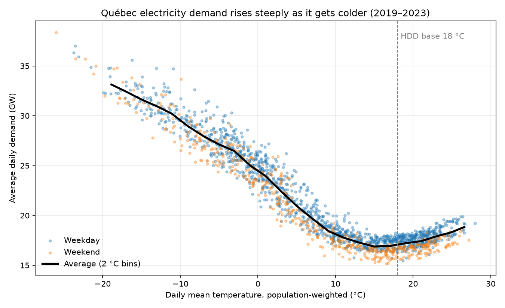
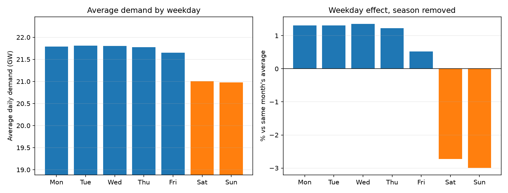
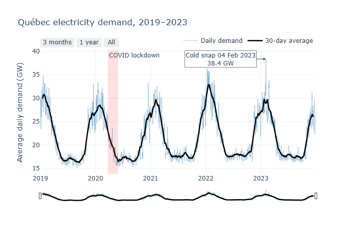
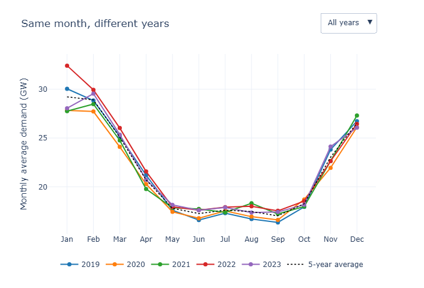
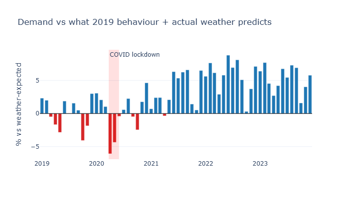

# Forecasting Québec's Electricity Demand


A day-ahead forecast of Québec's average daily electricity demand, built end to end: public data
ingestion and validation, exploratory analysis, a time-series backtest comparing statistical and
machine-learning models, documented experiments, and an MLOps pipeline (MLflow, DVC, CI/CD, AWS
Lambda, monitoring).

**Result:** the selected model (LightGBM predicting the day-over-day change in demand) forecasts
tomorrow's demand with a **1.93% mean absolute percentage error** over four held-out quarters,
**73% better** than the seasonal-naive baseline (7.23%).

---

## Contents

1. [The problem](#1-the-problem)
2. [Data](#2-data)
3. [Data preparation](#3-data-preparation)
4. [Exploratory analysis](#4-exploratory-analysis)
5. [Modelling approach](#5-modelling-approach)
6. [Baseline results](#6-baseline-results)
7. [Experiments](#7-experiments)
8. [Final model](#8-final-model)
9. [Production pipeline (MLOps)](#9-production-pipeline-mlops)
10. [Limitations and next steps](#10-limitations-and-next-steps)
11. [How to run it](#11-how-to-run-it)
12. [Repository structure](#12-repository-structure)

---

## 1. The problem

Every day, a grid operator needs to know how much electricity the province will use tomorrow, to
schedule generation and imports and to prepare for cold snaps. This project answers one question:

> **What will Québec's average electricity demand be tomorrow, in MW?**

The forecast is made each morning for the next day. It may use everything known up to today
(past demand, the calendar) and the weather expected for tomorrow.

---

## 2. Data

### Electricity demand: Hydro-Québec open data

- **Source:** Hydro-Québec, *Historique de la demande d'électricité au Québec*
  ([open data portal](https://www.hydroquebec.com/documents-data/open-data/history-electricity-demand-quebec/)).
- **Licence:** CC-BY-NC 4.0 (non-commercial use with attribution).
- **Format:** one Excel file per year, downloaded for **2019 to 2023**. Each file has one sheet with
  two columns:

  | Column | Content | Example |
  |---|---|---|
  | `Date` | Date and hour, day/month order | `01/01/2019 01:00` |
  | `Moyenne (MW)` | Average demand over the hour, in MW, French decimal comma | `23762,55` |

- **Granularity:** hourly, about 8,760 rows per year.
- **Hour-ending convention:** `01/01/2019 01:00` is the average of 00:00–01:00. The hour is labelled
  by its end, so the value stamped 00:00 belongs to the previous day.

### Weather: Open-Meteo historical archive

- **Source:** [Open-Meteo historical weather API](https://open-meteo.com/en/docs/historical-weather-api)
  (ERA5 reanalysis), free, no API key, CC BY 4.0.
- **Variables:** daily mean, maximum and minimum temperature at 2 m.
- **Locations:** demand follows heating where people live, not the temperature at one point, so
  temperatures from four cities are combined with population weights:

  | City | Weight |
  |---|---|
  | Montréal | 60% |
  | Québec City | 20% |
  | Gatineau | 10% |
  | Sherbrooke | 10% |

---

## 3. Data preparation

All steps are in `src/qc_demand/ingest.py` and run with `qc-demand ingest`.

1. **Download** the five yearly files (cached in `data/raw/`, so they are fetched once).
2. **Parse robustly.** The parser finds the timestamp and demand columns by their *content*, not
   their labels: the timestamp column is the one with the most date-like cells, the demand column
   the one with the most values between 5,000 and 60,000 MW. This survives label changes between
   years (the first version looked for "Demande" and failed on "Moyenne (MW)"). Text dates are read
   **day first**, so `05/02/2019` is 5 February, not 2 May, and French decimals (`23 762,55`) are
   converted.
3. **Shift timestamps back one hour** to convert hour-ending to hour-beginning. Without this, every
   midnight hour is assigned to the wrong day.
4. **Aggregate to daily:** mean demand (the target) and peak demand. A day with fewer than 20 valid
   hours is set to missing instead of being averaged on partial data.
5. **Join weather:** population-weighted daily temperatures from Open-Meteo.
6. **Fill short gaps:** gaps of at most 2 days are interpolated so lag features stay usable, and
   flagged in an `imputed` column.
7. **Validate, and stop on failure:** no duplicate dates, all demand between 5 and 50 GW (catches
   unit or parsing errors), and no more than 5% of days missing.

**Output:** `data/processed/daily.parquet`, one row per day from 2019-01-01 to 2023-12-31
(about 1,826 days) with `demand_mw`, `peak_mw`, `temp_mean`, `temp_max`, `temp_min` and `imputed`.

---

## 4. Exploratory analysis

Notebook: `notebooks/01_eda.ipynb`. Figures are in `reports/figures/`.

### 4.1 Demand vs temperature: heating drives demand



- **Below 10 °C, each degree colder adds about 552 MW** of average daily demand. Demand roughly
  doubles between mild days (~17 GW at 15 °C) and the coldest days (~33 GW at −19 °C), because most
  Québec buildings heat with electricity.
- **Demand bottoms out around 15 °C**, not the textbook 18 °C, and is flattest between 15 and 20 °C
  (17,029 MW on average). Well-insulated buildings with internal heat gains only need heating below
  about 15 °C.
- **Cooling exists but is small:** above ~20 °C demand rises again, from ~17 to ~19 GW at 26 °C.
- **The slope eases in extreme cold:** about 0.6 GW per degree between 10 °C and −10 °C, about
  0.35 GW per degree below −10 °C. There are few such days, so this is uncertain.
- **Temperature does not explain everything:** at a given temperature demand still varies by
  3–4 GW (weekday, holidays, recent demand).
- **Extreme days:** the five highest-demand days were all below −23 °C: the **3–4 February 2023
  cold snap** (38.4 GW on 4 February at −26 °C, the highest in the data) and three days in
  **January 2022**.

**Why this shapes the features: heating and cooling degree days.** The relationship is a hockey
stick, flat in the middle and rising on both sides, so raw temperature fits a linear model badly.
It is split into two features that are each roughly linear with demand:

- **HDD (heating degree days)** = max(0, base − temperature): how much heating the day needs.
- **CDD (cooling degree days)** = max(0, temperature − 18): how much cooling it needs.

The plot gave the evidence to test a 15 °C HDD base instead of the conventional 18 °C
(experiment 1).

### 4.2 Demand by weekday



The right panel compares each day with the average of its own month, which removes the
winter/summer effect and isolates the weekday:

| Mon | Tue | Wed | Thu | Fri | Sat | Sun |
|---|---|---|---|---|---|---|
| +1.3% | +1.3% | +1.4% | +1.2% | +0.5% | −2.7% | −3.0% |

The weekday–weekend gap is about **4%, roughly 0.9 GW**. That is several times the target forecast
error, so the model needs calendar features. It also explains why the baseline uses the same weekday
last week: with yesterday's value, every Monday forecast would start from a low Sunday.

### 4.3 Demand over time and the weather-adjusted view





Interactive versions (download and open in a browser):
[demand over time](reports/figures/demand_over_time.html) ·
[demand by year](reports/figures/demand_by_year.html) ·
[weather-adjusted gap](reports/figures/weather_adjusted_gap.html)

- **One dominant yearly cycle:** winter peaks (30-day average 28–33 GW) are close to double summer
  troughs (~16.5–18 GW).
- **Winters vary, and the weather explains it:** January averages range from ~28 GW (mild 2020, 2021
  and 2023) to 32.4 GW (cold 2022), clearly visible in the year-by-year chart. November 2020 was the
  lowest November (21.9 GW), also a mild month.
- **Short extremes barely move monthly averages:** February 2023 contains the highest day in the data,
  yet its monthly average (29.5 GW) is ordinary. This is why the forecast is daily.
- **Winter is far more volatile than summer**, so errors are expected to be largest in winter.

The raw chart cannot separate weather from other effects. To do that, a simple linear model was
fitted on **2019 only**: demand = base + HDD (15 °C) + CDD (18 °C) + weekend.

| Term | 2019 estimate |
|---|---|
| Base | 16,082 MW |
| Per heating degree | +519 MW |
| Per cooling degree | +303 MW |
| Weekend | −866 MW |
| Typical daily error on 2019 | 3.3% |

The estimates agree with sections 4.1 and 4.2 (552 MW per degree, weekends ~4% lower). Every later
day was then compared with what its actual weather predicts under 2019 behaviour:



- **COVID lowered demand by about 4.5% in spring 2020.** April–May 2020 came in 5.2% below the
  weather-expected level, against −2.3% in 2019 and +0.9% in 2021 for the same months: a
  **−4.5 point** effect, with April 2020 the lowest month (about −6%). Demand was back to normal by
  June. The raw data could not show this because spring 2020 was also mild.
- **Demand stepped up by about 5–6% from mid-2021 and stayed there:**

  | Year | 2019 | 2020 | 2021 | 2022 | 2023 |
  |---|---|---|---|---|---|
  | Gap vs 2019 behaviour, whole year | 0.0% | +0.1% | +3.4% | +5.7% | +5.3% |
  | Gap, summer (Jun–Aug) | +1.1% | +0.8% | +6.0% | +8.0% | +6.5% |

- **The extra load does not depend on the weather.** The step is larger in summer than over the year,
  which is what a roughly constant extra load (about 1 GW) looks like: the same MW is a bigger share
  of low summer demand. Plausible causes are new industrial and commercial consumers,
  electrification and population growth; the data alone cannot say which.

### 4.4 What the analysis means for the model

| Finding | Consequence |
|---|---|
| Heating drives demand, starting near 15 °C | HDD and CDD features; test an HDD base of 15 °C |
| Weekday effect of ~4% | Day-of-week, weekend and holiday features |
| Demand stepped up 5–6% in 2021 | A model that learns old levels will under-forecast: use lagged demand, an expanding training window, and regular retraining |
| Winter is volatile, with rare record-cold days | Evaluate per season; expect larger winter errors |
| Spring 2020 is unusual | Lagged demand lets the model adapt within days |

---

## 5. Modelling approach

### 5.1 Features

Built in `src/qc_demand/features.py`. **Leakage rule:** every demand-based feature for day D uses
data up to D−1 only, and a unit test enforces it.

| Group | Features |
|---|---|
| Calendar | day of week, weekend flag, month, day of year as sine and cosine, Québec holidays, Christmas break |
| Weather | mean, max and min temperature, HDD, CDD, daily temperature range, yesterday's temperature, change since yesterday |
| Past demand | demand 1, 2, 7 and 14 days ago; 7- and 28-day rolling means; 7-day rolling standard deviation |

### 5.2 Models

Three candidates, chosen to cover the range from trivial to flexible. Each implements the same
`fit` / `predict` interface, so the backtest treats them identically.

| Model | What it does | Why it is included |
|---|---|---|
| **Seasonal naive** | Tomorrow = same weekday last week | The baseline. A model that cannot beat it adds no value |
| **SARIMAX** | Seasonal ARIMA with a weekly cycle, plus HDD, CDD, holiday and Christmas-break regressors | The classical statistical benchmark; interpretable |
| **LightGBM** | Gradient-boosted trees on all features | The machine-learning candidate; captures non-linear effects and interactions |

All models start from default or standard settings (`params.yaml`), with no tuning, so the
comparison is about the approach, not tuning effort. SARIMAX is fitted on standardized demand: with
raw values around 20,000 MW, the optimizer produced degenerate fits where the AR and MA terms
cancelled out.

### 5.3 Evaluation: rolling-origin backtest with 4 folds

Implemented in `src/qc_demand/backtest.py`.

```
Training data (expanding)                          Test quarter
2019-01 ─────────────────────────────── 2022-07  │ Fold 1: 2022-07-02 → 2022-09-30 (summer)
2019-01 ──────────────────────────────────── 2022-09  │ Fold 2: 2022-10-01 → 2022-12-30 (autumn)
2019-01 ───────────────────────────────────────── 2022-12  │ Fold 3: 2022-12-31 → 2023-03-31 (winter)
2019-01 ────────────────────────────────────────────── 2023-03  │ Fold 4: 2023-04-01 → 2023-06-30 (spring)
```

For each fold, every model is trained on all data before the test quarter, then forecasts the
quarter **one day ahead at a time**, exactly as it would in production. Metrics are averaged over
the four folds.

**Why this design:**

- **Time order is respected.** A random train/test split would let the model learn from the future
  (for example, from days after the one it forecasts), giving falsely good results.
- **Expanding window.** Each fold trains on everything available at that point, as a production model
  would.
- **Four quarters, one per season.** Errors differ by season (winter is far harder), so testing on a
  single period could flatter or penalise a model by chance. Four folds give one test per season and a
  standard deviation across folds.
- **One full year of tests, 2022-07 to 2023-06.** All folds come after the 2021 demand step and include
  the February 2023 cold snap, so they test the hardest conditions in the data.
- **Second half of 2023 held out.** Training uses data up to 2023-06-30 only
  (`qc-demand train --until 2023-06-30`). July–December 2023 is never seen and is used to simulate
  production (section 9).

### 5.4 Metrics

| Metric | Meaning | Why |
|---|---|---|
| **MAPE** (selection metric) | Average error as % of actual demand | Readable ("off by 2%"), comparable across seasons |
| MAE | Average error in MW | The size of the error in grid terms |
| RMSE | Penalises large errors more | Large misses on cold days matter most |
| Bias | Average of (forecast − actual) | Shows a systematic lean high or low |

The model with the lowest average MAPE across the four folds is selected, then **refitted on all data
up to the cutoff** to produce the final model. All runs, parameters and metrics are tracked in
MLflow.

---

## 6. Baseline results

Default settings, HDD base 18 °C:

| Model | MAPE | MAE (MW) | RMSE (MW) | Bias (MW) |
|---|---|---|---|---|
| Seasonal naive | 7.23% | 1,716 | 2,286 | +4 |
| SARIMAX | 2.52% | 564 | 727 | +1 |
| **LightGBM** | **2.07%** | **502** | **691** | **−336** |

LightGBM wins on every error metric, but **it under-forecasts by 336 MW on average**, while SARIMAX
and the baseline are unbiased. Most of its error is therefore one systematic lean, not random noise.

Feature importance (share of LightGBM's total gain) confirms the analysis: **yesterday's demand
~64%**, **HDD ~21%**, **mean temperature ~11%**, everything else ~4%. Recent demand carries the level;
temperature drives the changes.

---

## 7. Experiments

Each experiment changed **one thing**, motivated by the analysis. A change was kept only if it reduced
MAPE by more than **0.1 point**: with four test quarters, smaller differences cannot be distinguished
from noise.

| # | Change | LightGBM MAPE | SARIMAX MAPE | Naive MAPE | LightGBM bias (MW) | Kept? |
|---|---|---|---|---|---|---|
| 0 | Baseline (HDD base 18 °C, predict demand level) | 2.07% | 2.52% | 7.23% | −336 | – |
| 1 | HDD base 15 °C | 2.04% | **2.28%** | 7.23% | −330 | **Yes** |
| 2 | LightGBM predicts the change from yesterday | **1.93%** | 2.28% | 7.23% | **−163** | **Yes** |
| 3 | LightGBM tuning (`num_leaves` 15, 1,200 trees, learning rate 0.02) | 1.87% | 2.28% | 7.23% | −177 | No |

### Experiment 1: HDD base 15 °C

**Why:** section 4.1 showed demand bottoming out at 15 °C, not 18 °C.

**Result:** SARIMAX improved clearly (2.52% → 2.28%), because it uses HDD as a linear input and a
base that matches where heating starts makes that line fit better. LightGBM barely moved
(−0.03 point, noise): it also sees raw temperature and had already found the kink. The naive model is
unchanged, as expected, since it uses no weather, which confirms nothing else changed. LightGBM's bias
was unchanged, so the bias does not come from the HDD base. **Kept.**

### Experiment 2: LightGBM predicts the change from yesterday

**Why:** a decision tree can only predict values it saw in training; each leaf outputs an average of
training examples. The test quarters contain demand levels above most of the training data (the 2021
step) and record cold (February 2023). The trees cannot reach those values, which explains the
−336 MW bias. Day-to-day *changes*, however, stay in a familiar range before and after 2021.

**Change:** the trees learn *demand − yesterday's demand*; the forecast is yesterday's demand plus the
predicted change (`target_base: lag_1` in `params.yaml`). Today's actual demand supplies the current
level. A unit test checks that this follows a simulated level shift that the level model misses.

**Result:** the bias **halved, from −330 to −163 MW**, and MAPE dropped from 2.04% to **1.93%**. This
confirms the diagnosis. The remaining bias likely comes from features that still describe the
absolute level (demand last week, rolling means) and from record-cold days outside the training range.
**Kept.**

### Experiment 3: LightGBM tuning

**Why:** smaller trees and slower learning can reduce overfitting.

**Result:** MAPE 1.93% → 1.87% (−0.06 point, below the noise threshold) and bias slightly worse. Not
worth twice the trees and three more settings to justify. **Not kept**: the defaults stay.

---

## 8. Final model

**Configuration** (`params.yaml`):

- HDD base **15 °C**
- **LightGBM** predicting the **change from yesterday's demand**, default hyperparameters
  (600 trees, learning rate 0.03, 31 leaves)
- Trained on all data from 2019-01-15 to **2023-06-30**

**Performance** (4-fold backtest, July 2022 – June 2023, one day ahead):

| | Value |
|---|---|
| MAPE | **1.93%** |
| Bias | −163 MW |
| Improvement over seasonal naive | **73%** (7.23% → 1.93%) |
| Improvement over the untuned baseline LightGBM | 2.07% → 1.93%, bias halved |

On an average day (~21 GW), a 1.93% error is about ±400 MW. SARIMAX (2.28%, unbiased) remains a close
second and a useful fallback: it is simpler to explain and extrapolates naturally to colder days.

**Selection, step by step:** each `qc-demand train` run backtests the three candidates
(3 models × 4 folds = 12 temporary models, scored and discarded), selects the lowest average MAPE, and
refits the winner once on all data up to the cutoff. That model is saved to `models/model.joblib`,
with its description and scores in `models/model_meta.json`, and a copy is stored in the MLflow run.

---

## 9. Production pipeline (MLOps)

```
 Hydro-Québec XLSX ─┐                                         ┌─> MLflow (runs, metrics, model)
 Open-Meteo ERA5  ──┼─> ingest ─> features ─> backtest ─> train (select + refit) ─> model.joblib
                    │   (validation)          (4 folds, 3 models)                     │
                    │                                                         DVC ──> S3
 EventBridge (daily) ──> Lambda container ──> predict ──> forecasts.csv ──> monitor ──> email alert
                                                          (S3, versioned)   (accuracy + drift)
 GitHub Actions: lint, tests, pipeline smoke run and Docker build on every push; monthly retrain
 Streamlit: stakeholder dashboard (forecast vs actual, error trend, model comparison)
```

| Component | What it does | Why |
|---|---|---|
| **MLflow** | Records every training run: parameters, per-fold metrics, model files | Compare experiments; recover any past model |
| **DVC** (`dvc.yaml`, `params.yaml`) | Declares the pipeline stages (ingest → train → replay → monitor) with their inputs and outputs; stores data and models in S3 | `dvc repro` reruns only what changed; any commit can be rebuilt exactly |
| **Tests** (`tests/`, 17 tests) | Parsing (including the real file layout and day-first dates), leakage, fold integrity, level-shift handling, drift detection, a full end-to-end run on synthetic data | Catch errors before they reach production |
| **CI** (`.github/workflows/ci.yml`) | Lint, tests, a full pipeline run on synthetic data, Docker build, on every push | A broken change is flagged before deployment |
| **AWS** (`Dockerfile`, `deploy/`) | A Lambda container runs daily at 06:23 Montréal time: loads the model and history from S3, forecasts the next day, appends to the forecast log, runs monitoring, emails an alert if needed | Runs unattended, inside the AWS free tier |
| **Monitoring** (`monitor.py`) | 14-day rolling MAPE vs the backtest MAPE (alert above 1.5×), and temperature drift (PSI) against the same season in training | Detects decay, and unusual weather before it causes errors |
| **Dashboard** (`app/dashboard.py`) | Forecast vs actual, error trend, model comparison, main drivers | Explains results to non-technical stakeholders |

**Why the drift check compares the same season:** comparing December temperatures with a whole year
of training data would raise an alarm every winter. The real question is whether this December is
unusual for a December.

**Two forecasting modes:**

- **Replay:** forecasts the held-out second half of 2023 one day at a time, using data the model never
  saw, so monitoring is scored against real actuals.
- **Live:** forecasts tomorrow using the Open-Meteo weather *forecast*, as it would in real operation.

### Production replay results (July–December 2023)

*To be completed after running the replay and monitoring:* replay MAPE ___%, bias ___ MW, monitoring
status ___, and any alerts and their explanation.

---

## 10. Limitations and next steps

**Limitations**

- **Replay uses observed temperature.** A live forecast uses forecast weather, whose error adds to the
  model's, especially in winter. Replay accuracy is therefore optimistic.
- **Remaining LightGBM bias (−163 MW).** Features such as demand last week and rolling means still
  describe the absolute level; expressing them relative to yesterday's demand could remove more of it.
- **Rare extremes.** There are only a handful of days below −23 °C, so errors on record-cold days are
  uncertain, and these are the days that matter most to the grid.
- **Daily averages only.** The grid is managed hour by hour and at peak; this project forecasts the
  daily mean.
- **Data.** Hydro-Québec's open data is operational, not audited, and its history currently ends in
  2023. Licence CC-BY-NC 4.0: suitable for a portfolio, not commercial use.

**Next steps**

- Prediction intervals (LightGBM quantile regression or SARIMAX intervals), evaluated for coverage
- Hourly and daily-peak forecasting (`peak_mw` is already prepared)
- Features relative to yesterday's demand, to reduce the remaining bias
- Live mode with the Hydro-Québec real-time feed and weather forecasts
- Automatic monthly retraining via `retrain.yml`

---

## 11. How to run it

Requires Python 3.11 (3.10+ works). Commands shown for Windows PowerShell.

```powershell
py -3.11 -m venv .venv
.venv\Scripts\Activate.ps1
pip install -e ".[dev,app,aws]" "dvc[s3]"
pytest -q                                        # 17 passed

qc-demand ingest                                 # download + clean data (add --synthetic for offline data)
qc-demand train --until 2023-06-30               # backtest, select, refit, log to MLflow
qc-demand predict --mode replay --start 2023-07-01 --end 2023-12-31
qc-demand monitor                                # accuracy and drift report

mlflow ui --backend-store-uri sqlite:///mlflow.db   # http://127.0.0.1:5000
streamlit run app/dashboard.py
```

With DVC configured, `dvc repro` runs the whole pipeline and reruns only the stages whose code, data
or parameters changed.

To deploy to AWS (needs the AWS and SAM CLIs and Docker):

```powershell
cd deploy
sam build --template template.yaml
sam deploy --guided
```

---

## 12. Repository structure

```
├── params.yaml                 all settings: data, features, backtest, models, monitoring
├── dvc.yaml                    pipeline stages for DVC
├── pyproject.toml              package definition, dependencies, `qc-demand` command
├── src/qc_demand/
│   ├── config.py               file paths and parameter loading
│   ├── cli.py                  command line: ingest, train, predict, monitor
│   ├── ingest.py               download, parse, clean, join weather, validate
│   ├── synthetic.py            realistic fake data for tests and CI
│   ├── features.py             calendar, weather and lag features (leak-free)
│   ├── models.py               seasonal naive, SARIMAX, LightGBM; metrics
│   ├── backtest.py             rolling-origin, expanding-window backtest
│   ├── train.py                backtest → MLflow → select → refit → save
│   ├── predict.py              replay and live forecasts, forecast log
│   └── monitor.py              accuracy decay and seasonal drift checks
├── notebooks/01_eda.ipynb      exploratory analysis
├── tests/                      17 tests
├── app/dashboard.py            Streamlit dashboard
├── Dockerfile                  Lambda container image
├── deploy/                     AWS SAM template and Lambda handler
├── .github/workflows/          CI on every push; monthly retrain
├── data/  models/  reports/  forecasts/    pipeline outputs
```

---

*Data: Hydro-Québec, Historique de la demande d'électricité au Québec (CC-BY-NC 4.0); Open-Meteo
historical weather API, ERA5 (CC BY 4.0).*